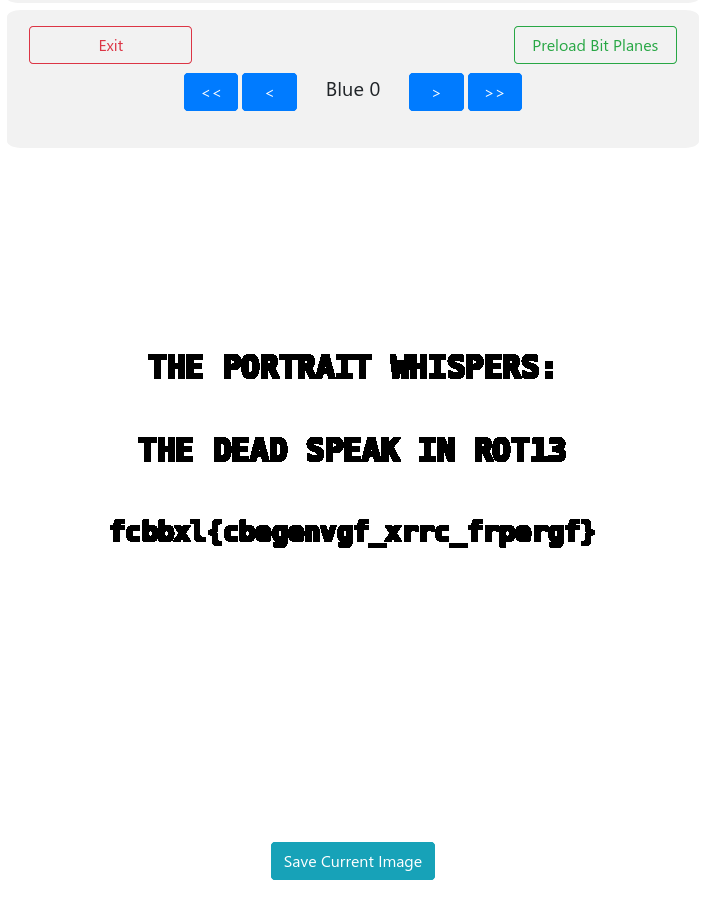

# The Haunted Portrait

*Challenge by Justin Pence*

I was provided with a png called `haunted_portrait.png`, with the challenge text denoting that when viewed at night, some claim the painting changes.

## Initial Attempts

My first thought with the "at night" hint was that maybe it was just a visual trick hiding in the dark areas of the image.

I opened it in Pinta (Image editor) and messed around with the brightness and contrast sliders, tried an edge detection filter and inverted the colors, but didn't find anything. Opened it in Photocraft (Yet another image editor) as well and checked each color channel for a hidden message. Nothing.

## Standard Forensics

I moved on going through my file forensics checklist I made from studying on PicoCTF.

`file`, `exiftool`, `pngcheck -vtp7`, `binwalk -e`, `strings -n 7 -t x ` -> Nothing, just a normal 8-bit RGB PNG.

I read a [StackOverflow Thread](https://stackoverflow.com/questions/25702272/ways-to-hide-secret-in-png-image-steganographyhttps://stackoverflow.com/questions/25702272/ways-to-hide-secret-in-png-image-steganography) that let me down a bit of a rabbit hole with `identify -verbose`.

It spat out a signature (9a04b646754023f1...), and just for the possibility I was onto something, I dumped it to hex with `xxd -r -p` and tried to decode it, but it was just some rude sounding gibberish (��Fu@#��dS�▒^�|�� ...). Normal hash or something, I guess. I'm not too familiar with CTF tooling so far.

## Finding the solution

I found a [checklist of image forensic steps for CTFs](https://www.georgeom.net/StegOnline/checklist). Turns out the site also hosts a tool to do most things on the list. Apparently images can be hidden inside of the colour/bit planes and by using the sites tool for extracting those I found a hidden message inside the Bit Plane **Blue 0**:



```
THE PORTRAIT WHISPERS:

THE DEAD SPEAK IN ROT13

fcbbxl{cbegenvgf_xrrc_frpergf}
```

Being familiar with ROT13 as Caesar's Cipher with the letters being shifted by 13 in the alphabet, I just grabbed [the next best decoder](https://cryptii.com/pipes/caesar-cipher/) and there we have it:

fcbbxl -> Reverse Caesar's Cipher13 -> spooky

cbegenvgf_xrrc_frpergf -> Reverse Caesar's Cipher 13 -> portraits_keep_secrets

🚩

```flag
spooky{portraits_keep_secrets}
```
