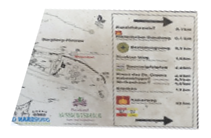

# MIA

*Challenge by LoadinConfusion*

For this challenge, we were given a photo and a brief scenario about a missing informant. The challenge text mentions that the informant wanted to visit a "historical site for a drop-off" but that they were likely brought "somewhere nearby to hide".

The photo was of a shovel in a grave-sized hole in an area with rooty dry dirt. Three more images were hyperimposed on it. A little card, a map and a sign in the dirt, "Grabpflege".

## Google Image analysis

There was a card visible in the image, looking like small visitor card to some place. I cropped it out and perspective warped it correctly in PhotoCraft (Image editor):


I ran it through a reverse Google image search. This pointed me to a "Blankenburg HarzCard". A visitor's pass to castles in Germany.

Now I did the same to the low resolution image of some kind of map on the picture.



The image search got me the high-resolution version of the map to a castle called Burgberg.

The map had a marker placed at the current location of where the map would be hanging at on the castle perimeters. The marker said "Burgberg Seilbahn".

I tried to bring that into flag format, `spooky{Burgberg_Seilbahn}`, which was incorrect.

## Finding the Solution

I read the text more clearly and it said the individual brought them somewhere **nearby** to hide. And as there was a sign called "Grabpflege" nearby, German for "grave care", so I looked for a "Friedhof" (graveyard) nearby.

I looked through the Google Reviews of the nearby graveyards and the "Friedhof Bad Harzburg" was the most similar in dirt quality to the picture. I brought it into flag format.

🚩

```flag
spooky{Friedhof_Bad_Harzburg}
```
