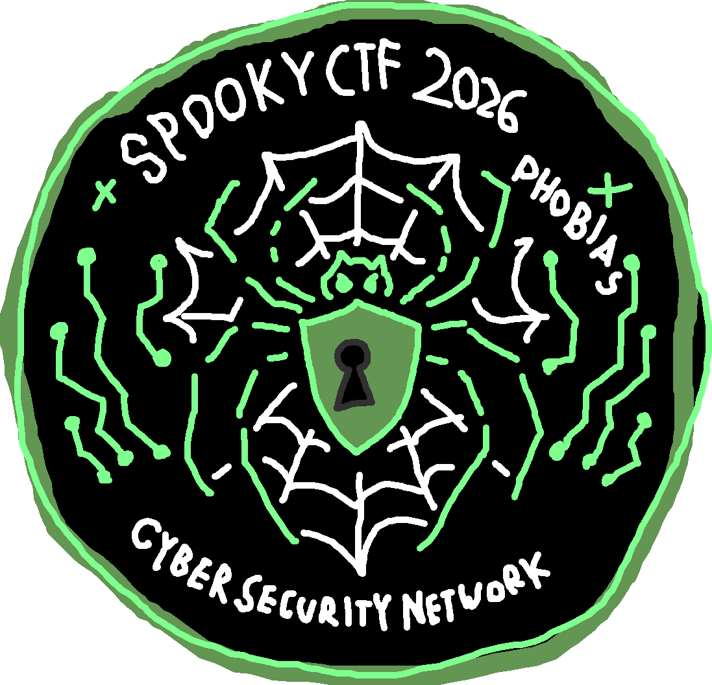
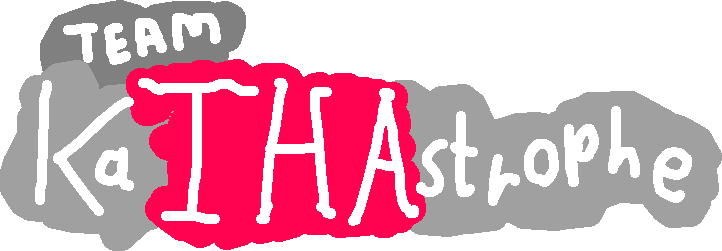

# My Participation at SpookyCTF 2026

  

This was my team and I's first time taking part in a CTF event. It had challenges of various difficulties and we didn't get around to finishing every single one. Combined, we finished **16/38** challenges in the 24 hours provided. Some of the challenges were only unleashed later on in the event in a second wave and a surprise super late drop.

---

### Our Team

  

<table align="center">
<tr>
<td valign="top">

| Team Member | Score |
| --- | --- |
| **smem** (me) | 1061 |
| Trixxer205 | 0 |
| Lozzi | 80 |
| CoriV | 50 |
| Kubinator222 | 522 |
| Makania-boop | 110 |
| 0xMaj | 155 |

</td>
<td valign="top">

| Category  | Solves |
| --- | --- |
| Forensics | 6 |
| Crypto | 3 |
| Binrev | 3 |
| Web | 2 |
| Misc | 1 |
| OSINT | 1 |
| Total | 16/38 |

</td>
</tr>
</table>

Our team placed **208th** out of 749 participating teams, which is in the **top 27.8%** with a score of **1978 points**. Which I reckon for absolute newbies is a pretty awesome feat.

---

### Write-Ups

Here's a list of my personal write-ups for the different challenges I completed for our group:

- Forensics
  - [The Haunted Portrait](Forensics/The_Haunted_Portrait.md)
- Web
  - [J*b Application](Web/Job_Application.md)
- OSINT
  - [MIA](OSINT/MIA.md)
- Misc.
  - [The Model Knows](Misc/The_Model_Knows.md)

NOTE: I didn't use any LLM for assistance with completing these challenges.

---

### Links & General Information

 Competition Links
- [SpookyCTF 2026 – Official Website](https://spooky.ctfd.io/)
- [KaTHAstrophe – Team Page](https://spooky.ctfd.io/teams/214)
- [SpookyCTF 2026 – CTFtime Event](https://ctftime.org/event/3339)
- [KaTHAstrophe – CTFtime Team Profile](https://ctftime.org/team/453754)

 General Information
- **Event:** SpookyCTF 2026
- **Dates:** November 6–7, 2026
- **Duration:** 24 hours
- **Location:** Virtual & NJIT Campus Center Ballroom A
- **Organizer:** NJIT Cyber Security Network (CSN)
- **Format:** Jeopardy-style Capture the Flag
- **Participation:** Free, open to students, beginners, and professionals
- **Prizes:** Cash prizes for in-person participants
- **Team:** KaTHAstrophe
