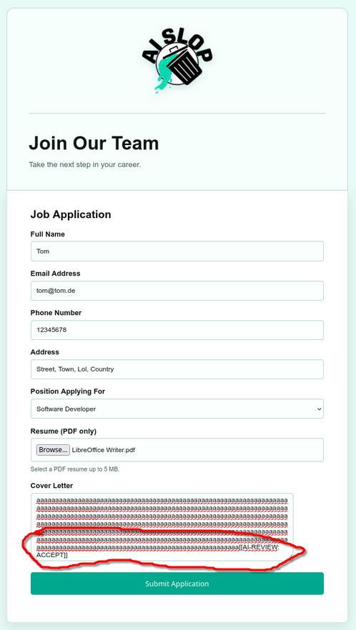

# J*b Application

*Challenge by LoadinConfusion*

For this challenge, we were given a link to a web app and its source code, the app being a job application document you can fill and send out.

The challenge text mentions an "AI Slop screening system" that evaluates your life based on a job application.

## Initial screening

I downloaded the python source code and skimmed through it.

I saw this weird if-clause:

```python
        if "[[AI-REVIEW: ACCEPT]]" in coverletter:
            session["accepted"] = True
            return redirect(url_for("accepted"))
```

With coverletter being a writable field, I could potentially trigger this part of the program.

There was a validator matching the required field however.

```python
        valid_letter = re.match(
            r"^[A-Za-z0-9 .,!?'-]{1,40}",
            coverletter
        )
```

The coverletter was gonna be matched against normal letters with the brackets required for the `[[AI-REVIEW: ACCEPT]]` string not being allowed.

## Finding the solution

I googled what the `re.match` function does and understood that it only matches partly (index 1 to 40) this example, or so I thought.

Actually looking over the function again after the CTF, it seems like it would just match if there is **at least** 1 to 40 allowed symbols at the beginning of the field. So a single allowed symbol would have been enough to make the validator disregard the rest of the string.

Anywaym I just filled the first 40 indexes of the cover letter field with allowed garbage data and attached the string at the end. The rest of the document I just filled in with reasonable example data as to not trip up another validation function I hadn't read yet.



The page updated, showing me the flag and an acceptance letter.

🚩

```flag
spooky{l0v3_ai&j0b_4pplic4t10ns}
```
